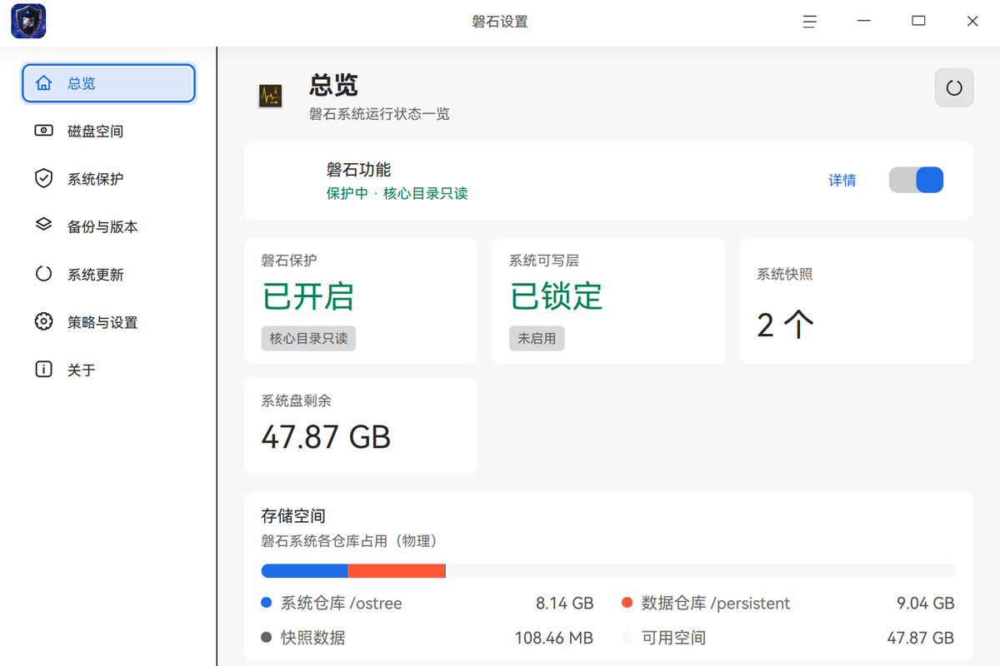
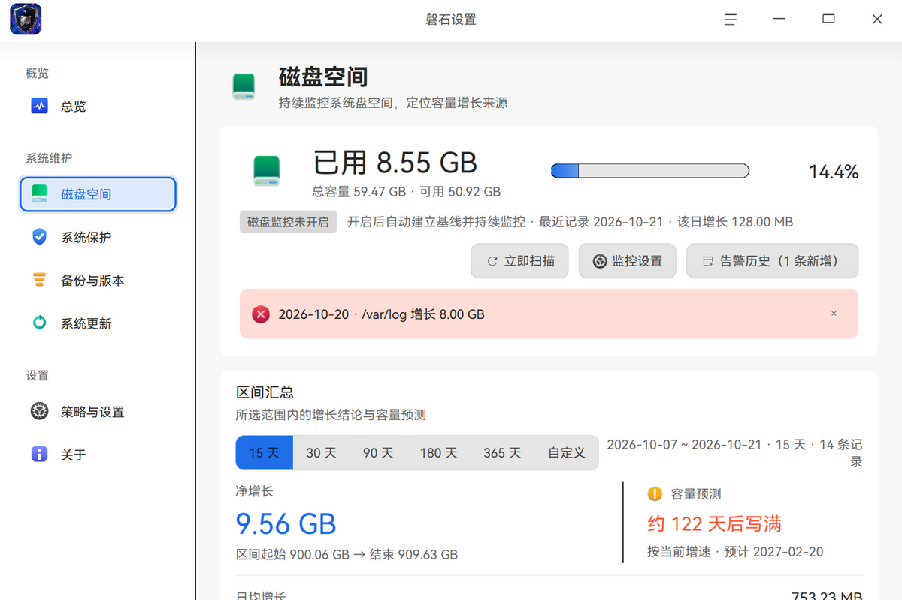
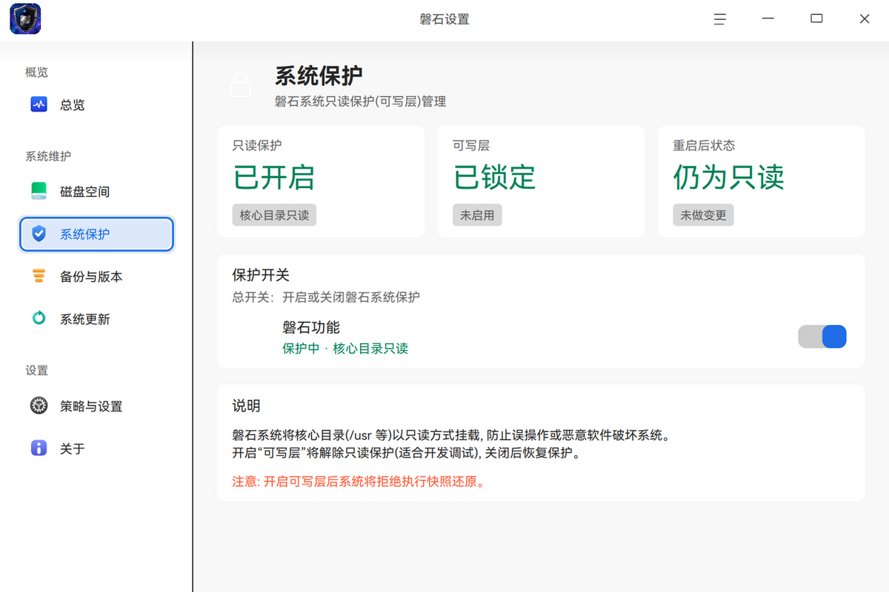
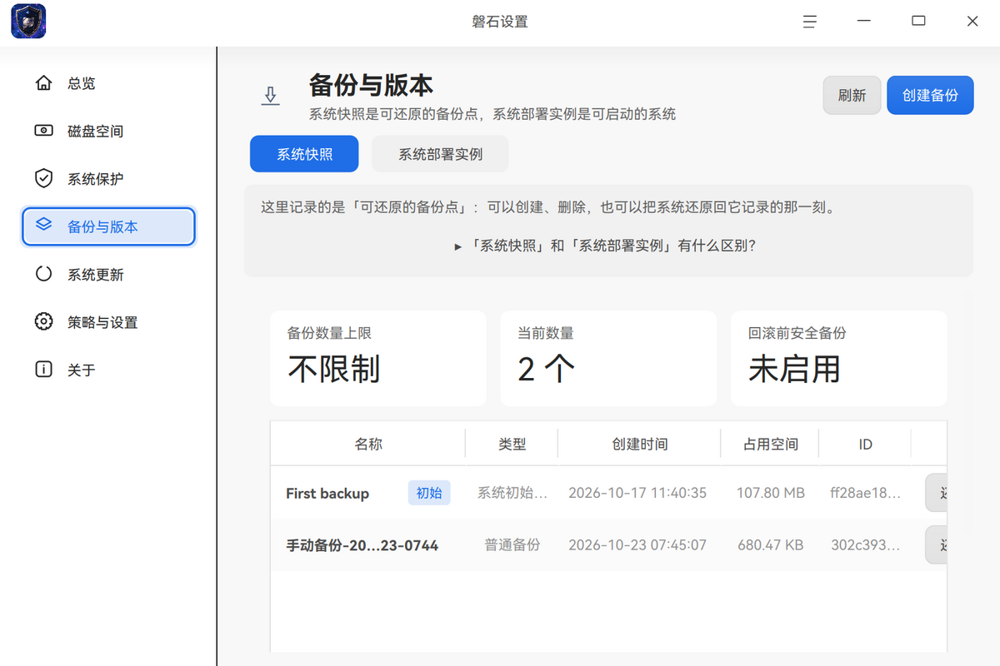
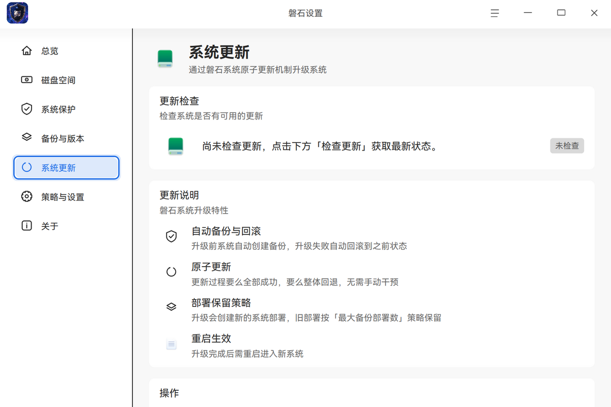
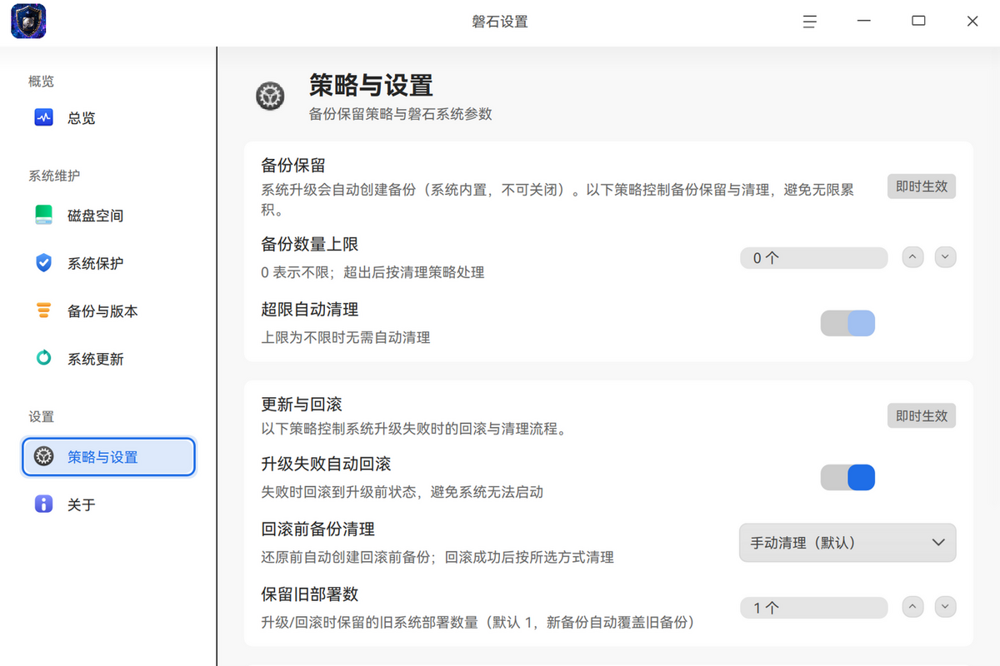
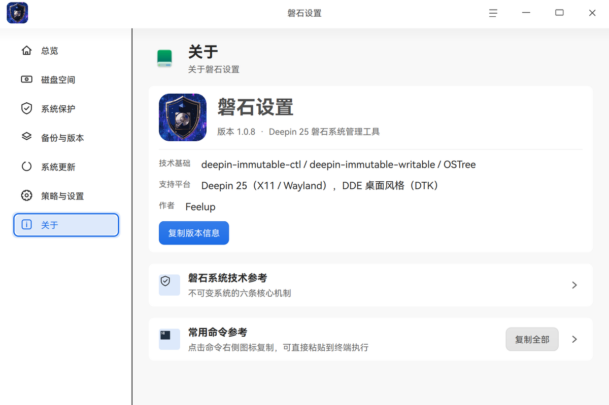

<div align="center">


<h1>磐石设置 · Panshi Manager</h1>

<p><b>Deepin 25「磐石」不可变系统的图形化管理工具</b><br/>
基于 C++17 / Qt6 / DTK6 原生构建，融入 DDE 桌面</p>

<p>
  <a href="https://github.com/GBooter/panshi-manager/releases/latest"></a>
  
  
  
  
  
</p>

<p>
  <a href="#-界面一览">界面</a> ·
  <a href="#-下载与安装">下载安装</a> ·
  <a href="#-从源码构建">源码构建</a> ·
  <a href="#-技术说明">技术说明</a> ·
  <a href="#-许可证">许可证</a>
</p>

</div>

---

## 这是什么

Deepin 25（代号「磐石」）把系统盘做成了 **ostree 不可变镜像**：核心目录以只读方式挂载，
系统升级是整镜像原子切换，出问题可回滚到某个快照。这些能力原本只有命令行能操作，
`deepin-immutable-ctl` 的参数和 JSON 输出对普通用户并不友好。

**磐石设置**把这一整套机制做成了图形界面：保护开关、快照与回滚、部署版本、原子升级、
磁盘空间守护、备份保留策略——六个功能页面覆盖日常全部操作，危险操作带后果说明与二次确认。

界面完全使用 **DTK6**（Deepin Tool Kit）原生控件与 `DPalette` 取色，
主题、图标、字号随系统设置自动变化，亮色/暗色无需额外适配。

---

## 🖼 界面一览

> 以下截图取自 v1.0.8 实机运行（简体中文、系统浅色主题）。

### 总览

一屏看清当前系统状态：磐石功能是否开启、可写层是否解锁、快照数量、系统盘剩余空间，
以及 `ostree` 系统仓库 / `persistent` 数据仓库 / 快照数据的物理占用分布。



### 磁盘空间

持续监控系统盘占用的变化，而不是只给一个「还剩多少」。按 **15 / 30 / 90 / 180 / 365 天或自定义区间**
汇总净增长与日均增长，并据此做**容量预测**（按当前增速多少天后写满）；异常增长直接在时间线上标红，
点击可下钻定位到具体目录。后台由 systemd 用户级定时任务采样，策略经 DConfig 持久化。



### 系统保护

只读保护、可写层、重启后状态的当前值与操作入口。总开关区分三种意图：
普通开关、**临时开启可写层（重启还原）**、**完全关闭保护（需 30 秒倒计时确认）**，
并在开启可写层时明确提示「将拒绝执行快照还原」。



### 备份与版本

把两个容易混淆的概念分开呈现——**系统快照**是可还原的备份点，**系统部署实例**是可启动的一整套系统。
支持新建快照、还原到某个快照（还原前自动创建「回滚前备份」）、清理旧部署。
顶部有一键展开的「两者有什么区别」说明，避免用户误操作。



### 系统更新

检查更新、执行原子升级、清理缓存。检查完成后给出**待更新软件包明细**：
按用途分组、组标题带数量徽章、包名中部省略悬停显示全名，解决「只报一个数字，不知道要更新什么」的问题。
数据取自 apt 只读视图（不提权），与磐石升级计数同源互证。



### 策略与设置

备份保留上限、超限自动清理、升级失败是否自动回滚、回滚前备份的清理方式、保留旧部署数量。
参数按作用域分组标注——**应用级**即时保存，**系统级**需显式保存，改之前就知道会影响什么。



### 关于

版本信息、技术基础与支持平台集中在一张卡上，可一键复制成一段文本。下方是两张**可折叠**的参考卡：
「磐石系统技术参考」给出不可变系统的六条核心机制，「常用命令参考」列出常用的
`deepin-immutable-*` 命令，支持逐条复制或一键复制全部。两张卡默认收起，点击标题行即可展开。



---

## 📦 下载与安装

适用于 **Deepin 25 / UOS v25（ostree 不可变版）**，架构 `amd64`。

从 [**Releases**](https://github.com/GBooter/panshi-manager/releases/latest) 下载 `.deb` 后：

```bash
sudo apt install ./panshi-manager_1.0.8_amd64.deb
```

启动器搜索「磐石设置」，或运行 `panshi-manager`。

<details>
<summary>卸载 / 命令行参数 / 校验值</summary>

```bash
sudo apt remove panshi-manager        # 卸载
panshi-manager --show-disk            # 直接打开磁盘空间页
panshi-manager --monitor              # 后台采样（由 systemd timer 调用）
```

当前版本 `v1.0.8` 安装包 SHA-256：

```
8bf5d636bd78c64c68a7b1e8bebe4c89885441c9e5446e8d59dac3eadc352803
```

</details>

### 系统要求

| 项目 | 要求 |
|---|---|
| 操作系统 | Deepin 25 / UOS v25（ostree 不可变系统） |
| 架构 | amd64 |
| 运行时依赖 | Qt 6（core / gui / widgets / dbus / svg）、DTK 6（core / gui / widget） |
| 权限 | 管理磐石状态需 root，程序自动通过 `sudo -n` 或 `pkexec` 提权，**无需以 root 身份启动** |
| 相关工具 | `deepin-immutable-ctl`、`deepin-immutable-writable`（系统自带） |

> 依赖由 `apt install` 自动解析，无需手动逐个安装。

---

## 🔨 从源码构建

```bash
# 构建依赖（Deepin 25）
sudo apt install -y cmake g++ qt6-base-dev \
                    libdtk6core-dev libdtk6gui-dev libdtk6widget-dev

# 可选：仅在需要更新翻译 .ts 时安装
sudo apt install -y qt6-tools-dev-tools

cmake -B build -DCMAKE_BUILD_TYPE=Release
cmake --build build -j"$(nproc)"

sudo cmake --install build     # 安装到 /usr
```

不想安装也可以直接跑构建产物：

```bash
QT_QPA_PLATFORMTHEME=deepin ./build/panshi-manager
```

一键安装脚本：`sudo ./install.sh`。

> **版本号只有一个来源**：`CMakeLists.txt` 的 `project(VERSION)`，经编译期宏 `PANSHI_VERSION`
> 下发到界面与后台进程；打包脚本会校验它与 `debian/changelog` 一致，不一致直接中止。
> 修改版本号请只改这两处。

---

## ⚙️ 技术说明

**架构**：`DApplication` 单入口 →`DMainWindow` + 自绘 `QListView` 分组侧栏（带设置搜索）→
六个页面继承统一基类 → 后端 `Backend` 封装 `QProcess` 调用磐石命令。
磁盘监控子系统在 GUI 与 `--monitor` 后台进程间共用同一份采样/配置代码。

**几个设计取舍**：

- **颜色只走 `DPalette`**。语义收敛为 `PanshiUi::Semantic`（Muted / Normal / Accent / Success / Warning / Danger），
  QSS 只负责布局，不写任何色值——否则切主题必花。
- **图标用 `DIconTheme::findQIcon()`** 取系统主题图标（自动 symbolic 回退），随系统图标主题变化；
  切主题时监听 `applicationPaletteChanged` 并深度重绘，否则图标是旧主题的快照。
- **三档加载态**：L1 骨架屏 / L2 局部加载 / L3 顶部细进度条，取代「全页遮罩转圈」。
- **成功操作零模态弹窗**：结果用页内 Banner 呈现（成功自动消失，失败常驻可关）。
- **跨页跳转带「到达后动作」**：如总览页「立即创建备份」直接跳到备份页并弹出新建框，
  动作挂在目标页 refresh 完成之后执行，避免读到旧数据。
- **弹性布局防裁切**：所有页面置于 `QScrollArea`，卡片行按可用宽度自动折列，长文本统一 wordwrap + 中部省略。

**关键实现细节**：

- 快照占用 = 数据目录物理大小 + 独占 OSTree 对象大小（跨快照去重计算）
- 还原走官方 `snapshot rollback`，重启后生效；可写层开启时拒绝还原
- 回滚前自动创建「回滚前备份」并记录状态，可选重启 3 次后自动删除（systemd timer）
- 磁盘监控由 systemd 用户单元（oneshot + 15 分钟 timer）驱动，`TimeoutStartSec=30min` 防长扫描被掐断
- DConfig 为主配置源，`QSettings` 仅在 DConfig 不可用时降级，写入时双写保持一致
- 国际化走 `tr()` + Qt Linguist，`.qm` 随包安装，提供简体中文 / 英文

---

## 目录结构

```
panshi-manager/
├── CMakeLists.txt
├── src/
│   ├── main.cpp              # DApplication 入口（--monitor / --show-disk）
│   ├── mainwindow.h/cpp      # 主窗口 + 侧栏导航 + PageId 跳转 + 跨页动作队列
│   ├── backend.h/cpp         # 磐石命令封装（QProcess）
│   ├── style.h               # 布局类 QSS（颜色职责归 DPalette）
│   ├── ui/                   # 组件层：tokens / components / 确认对话框 / 侧栏 / 搜索索引
│   ├── pages/                # 六个功能页 + 关于页 + 页面基类
│   ├── widgets/              # 自绘控件（时间线图表 / 覆盖层 / 倒计时）
│   └── disk/                 # 磁盘监控子系统（GUI 与 --monitor 共用）
├── data/icons/               # 应用图标
├── translations/             # zh_CN + en_US 翻译源
├── tools/                    # 开发期验证探针 + 截图采集脚本
├── debian/                   # Debian 打包
├── docs/screenshots/         # README 截图
└── install.sh
```

---

## 开发文档

改代码前建议先读这两份：

- [`docs/开发指南.md`](docs/开发指南.md) —— 代码地图、扩展开发模板（新增页面 / 设置项 / 组件 / 后端命令 /
  磁盘指标 / DConfig 键 / 图标 / 语言 / 探针 / 跨页动作）、UI 编码红线、四层验证体系，
  以及按成因分组的经验教训。
- [`docs/开发文档.md`](docs/开发文档.md) —— 字段级精确参考。

`tools/` 下是开发期验证探针（离屏渲染截图 + 断言），改对应模块后应重跑，例如：

```bash
cmake --build build --target panshi-diskshot && ./build/panshi-diskshot
cmake --build build --target panshi-darkprobe && ./build/panshi-darkprobe
```

---

## 许可证

本项目以 **GNU General Public License v3.0 或更高版本（GPL-3.0-or-later）** 发布，
全文见 [LICENSE](LICENSE)。源文件头部统一使用 SPDX 标识：

```
SPDX-License-Identifier: GPL-3.0-or-later
```

Copyright © 2026 Feelup

---

<div align="center">
<sub>磐石设置 · 为 Deepin 25 不可变系统而生</sub>
</div>
